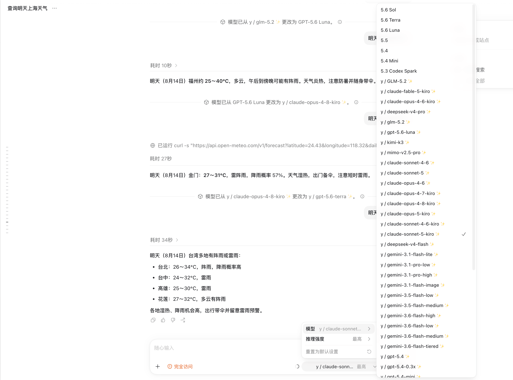
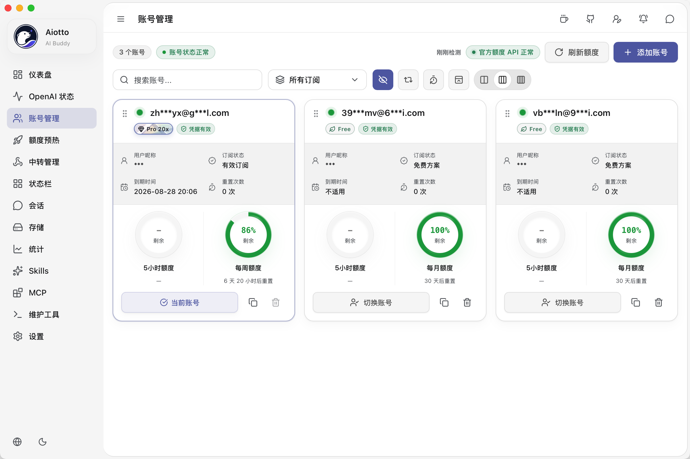
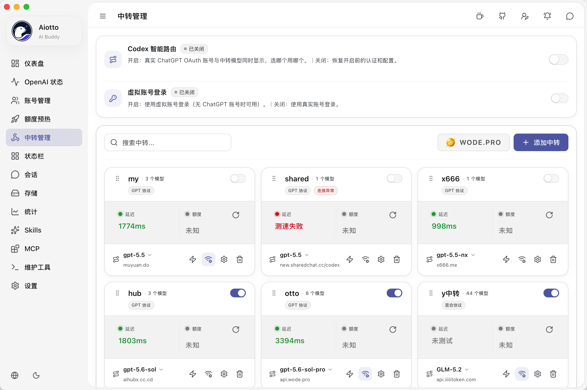

<h1 align="center">把你常用的模型，接进 Codex。</h1>

<p align="center">
  Aiotto 是配合 Codex 桌面端使用的模型接入与账号管理工具。接入已有的 Coding Plan、Token Plan 或 API，在熟悉的界面里使用已适配的工具继续任务；账号额度、用量和历史会话，也能集中管理。
</p>

<p align="center">
  简体中文 · <a href="./README_EN.md">English</a>
</p>

<p align="center">
  <a href="https://github.com/ShawnZhuge/aiotto/releases/latest"></a>
  <a href="https://github.com/ShawnZhuge/aiotto/releases"></a>
  
  
  
</p>

<p align="center">
  <a href="https://github.com/ShawnZhuge/aiotto/releases/latest"><strong>下载 Aiotto</strong></a>
  ·
  <a href="#in-action">查看使用界面</a>
</p>

<p align="center">
  
</p>

<p align="center"><sub>封面使用较早版本的界面示意；具体型号与支持范围见下方能力表。</sub></p>

> 支持 macOS 和 Windows。本页介绍已发布功能；更新内容见 [发布说明](https://github.com/ShawnZhuge/aiotto/releases)。模型能力以对应套餐、协议和已验证型号为准。

[真实界面](#in-action) · [功能一览](#features) · [账号与测智](#accounts) · [能力对照](#capabilities) · [开始使用](#start)

<a id="in-action"></a>

## 已有模型服务，在 Codex 里接着用

已经有 Coding Plan、Token Plan 或 API？在 Aiotto 添加对应供应商，就能在 Codex 模型列表中选择已接入的模型。

- **官方与第三方，同屏选择。** 按当前任务的需要，选用已经接入的模型。
- **换一个模型，接着处理任务。** 在同一对话中切换，保留能够携带的消息与工具结果，具体范围见[能力对照](#capabilities)。
- **已适配的工具，继续参与工作。** 读文件、跑命令、改代码，工具执行结果回到当前对话。

<p align="center">
  
</p>

<p align="center"><sub>真实界面示例。截图中的型号与菜单来自当时版本，当前可用项以账号、供应商配置和对应版本为准。</sub></p>

有 ChatGPT 账号，可以同时使用官方与第三方模型；没有账号，也可通过已配置供应商使用无账号模式。明确选择某个供应商后，若请求失败，Aiotto 会报告原因，不悄悄换用其他供应商或官方额度。

<a id="features"></a>

## 功能一览

如果你每天都用 Codex，Aiotto 可以帮你少做几件琐事：换模型时少改配置，换账号前先看额度，查用量时不必翻日志。

| 功能 | 你能做什么 |
| --- | --- |
| 模型接入 | **官方与第三方模型在 Codex 同屏选择**；支持三协议、模型搜索分类、批量选择和供应商配置导入导出 |
| 工具与续聊 | 用已适配模型读文件、跑命令、改代码；**同一任务换模型**时，保留可携带的对话历史和工具结果 |
| 无账号使用 | 没有 ChatGPT 账号，也可开启无账号模式，通过已配置的供应商模型开始任务 |
| 手机远程使用 | 电脑端配置好供应商后，使用同一 ChatGPT 账号在手机上远程操作这台电脑的 Codex 会话，也能选择已接入的模型 |
| 账号管理 | 保存账号快照，查看套餐、登录状态及账号提供的 5 小时、每周或每月额度；**剩余额度和重置倒计时**同屏展示，支持排序与一键切换 |
| 分组与迁移 | 给账号分组、筛选和批量整理；导入 JSON 前先预览、再选择，重复账号默认跳过，导入不切换当前账号 |
| macOS 状态栏 | 不打开主窗口，也能查看账号额度、重置倒计时和最近会话，以及供应商的状态、协议、网络方式与延迟 |
| 连接测速 | 发起真实流式请求，查看供应商连接状态和延迟；可依次测试已配置模型的供应商，比较本轮结果 |
| 鹈鹕测智 | 选择账号、模型、思考强度和并行数，查看生成过程与历史结果；支持取消、失败项重试和导出 |
| 用量统计 | 按官方或供应商、模型和日期筛选，逐请求查看 Token、缓存、延迟、状态与折算费用；macOS 可开启会话内 Token 和上下文占用显示 |
| 会话整理 | 按内容、目录或 ID 搜索历史，用对话目录定位长对话；支持置顶、继续、批量归档、恢复和导出 |
| 提醒与预热 | 按剩余额度百分比设置提醒，达到阈值时提示切换；预热计划可绑定账号与模型，支持测试、冲突检查、下次执行和最近结果查看 |
| 备份与清理 | 查看存储树图和大文件排行，创建备份快照并按范围恢复；永久清理前建立安全备份，保护活跃和近期会话 |
| 状态与维护 | 查看 OpenAI 服务状态，检查 Aiotto 应用更新及账号、供应商与运行状态；查看本地 Skills / MCP 清单，按需导出或发送脱敏诊断 |

<a id="accounts"></a>

## 账号多了，也能管理得清楚

哪个账号还有额度、什么时候重置、接下来该用哪个，在同一页就能看清。

| 你关心的事 | Aiotto 怎么帮你 |
| --- | --- |
| 还有多少额度？ | 查看账号提供的 5 小时、每周或每月额度，以及精确重置时间和倒计时；按剩余额度百分比设置提醒，达到阈值时提示切换 |
| 想换一个账号？ | 保存已登录账号的快照，点击卡片切换，也可快速切到下一个可用账号 |
| 账号太多不好找？ | 按组筛选，按额度、重置时间、订阅有效期或自定义顺序排列 |
| 需要批量整理？ | 批量管理分组；移出分组不会删除账号 |
| 已有账号想迁入？ | JSON 导入前先预览和选择，重复项默认跳过；导入不会切换当前账号 |

<p align="center">
  
</p>

<p align="center"><sub>较早版本的界面示例，账号信息已掩码；分组等新版布局以实际安装界面为准。</sub></p>

已有账号数据可从 JSON 文件导入，先预览、再选择；重复账号默认跳过，导入不会切换当前账号。支持 Aiotto 备份及部分 Codex、New API、Sub2API、Cockpit Tools 的 Codex / ChatGPT OAuth 凭据格式，实际可用性仍需认证确认。

### 🦩 鹈鹕测智：把测试过程和结果留在一起

选择已保存的 ChatGPT OAuth 账号，设置模型、思考强度和并行数，即可查看生成过程、结果详情与历史记录。支持取消、失败项重试和导出，便于回看不同测试的输出。

测试会发起真实请求并消耗相应额度。凭据失效时需要重新授权，结果仅供本次任务参考。

### ⏰ 额度预热：按账号安排，执行后核对

预热计划可绑定账号，选择自动或固定模型，并按组安排时间。支持先测试计划、检查时间冲突、查看下次执行时间和最近结果。执行详情展示请求前后的额度窗口采样，区分已确认、已启动与待确认状态。

运行时需保持 Aiotto 开启、电脑唤醒并联网。**预热不保证额度刷新、延长或重置，窗口变化以服务端为准。**

<details>
<summary>📦 供应商管理、用量统计与日常维护</summary>

### 供应商多了，模型仍然好找

按名称或 ID 搜索模型，按命名空间分类、仅看已选，或批量选择当前筛选结果。供应商配置可导入、导出；新增导入项默认停用，核对后再启用。

连接测试会发起真实流式请求，也可依次测试已配置模型的供应商，查看本轮最快结果。测速可能消耗额度；订阅账号额度、API 余额和本地折算费用分别呈现。

<p align="center">
  
</p>

### 用量与缓存，回看有依据

按官方或供应商、模型和日期筛选，查看每个请求的输入、输出、总 Token、缓存、延迟、状态及折算金额。统计异常和额度缓存整理会显示状态反馈；实际账单以供应商为准。

macOS 可按需开启会话内 Token 与缓存统计，查看本轮用量和上下文占用。开启后需重启 Codex，停用后也需重启才能彻底关闭。

### 会话和数据，按需整理

按内容、目录或 ID 搜索会话，用对话目录定位长对话；支持置顶、继续、批量归档、恢复和导出。归档或恢复后如提示目录未完全同步，请勿重复执行。

存储树图和排行帮助定位大文件。永久清理前创建安全备份，并保护活跃、置顶、运行中和近期会话；备份中心支持查看快照和按覆盖范围恢复。

### 状态与诊断，随时可查

不打开主窗口，也能在 macOS 状态栏查看当前与其他账号的额度、精确重置时间、倒计时和最近会话，以及各供应商的状态、协议、网络方式与延迟。隐私模式会隐藏敏感信息，保留切换入口。

维护页可检查账号、供应商和运行状态，导出或发送脱敏诊断并获得诊断编号。Skills / MCP 页面可查看本地清单、来源、配置和状态。

OpenAI 服务状态页展示官方服务是否降级或中断，以及事故处理更新；应用更新入口可检查 Aiotto 新版本。

</details>

<a id="capabilities"></a>

## 能接哪些模型，能做哪些事？

Aiotto 支持 Responses、Chat Completions 和 Anthropic Messages。接入时选择对应协议，再按模型确认工具和多模态能力。

**✅ 原生保留　🔄 桥接可用　⚠️ 有限制或未通过　⬜ 尚未确认　🚫 该路径不提供**

原生与桥接都可以完成各自已验证的任务，具体限制见备注。⚠️ 和 ⬜ 不列为支持承诺，⬜ 也不等于不支持。先找到自己的厂商和套餐，再对照协议与能力。

### 三协议能力一览

Responses 下分官方账号与第三方接入两条路径；它们属于同一协议，但可用能力不同。表格先区分接入方式，再说明各自的支持范围。

<table>
<thead>
<tr><th rowspan="2" scope="col">能力</th><th colspan="2" scope="colgroup">Responses</th><th rowspan="2" scope="col">Chat Completions</th><th rowspan="2" scope="col">Anthropic Messages</th></tr>
<tr><th scope="col">官方账号 · 透传</th><th scope="col">第三方接入</th></tr>
</thead>
<tbody>
<tr><th scope="row">文本对话</th><td>✅</td><td>✅</td><td>🔄</td><td>🔄</td></tr>
<tr><th scope="row">流式回答与结束状态</th><td>✅</td><td>✅</td><td>🔄</td><td>🔄</td></tr>
<tr><th scope="row">推理档位</th><td>✅ 按官方模型</td><td>✅ / 🔄 按型号</td><td>🔄 按型号</td><td>🔄 按型号</td></tr>
<tr><th scope="row">函数工具与结果回传</th><td>✅</td><td>✅ / 🔄 按目标</td><td>🔄</td><td>🔄</td></tr>
<tr><th scope="row">多个工具并行调用</th><td>✅ 按模型</td><td>✅ / 🔄 部分目标</td><td>🔄 部分目标</td><td>🔄 部分目标</td></tr>
<tr><th scope="row">Apply Patch 代码补丁</th><td>✅</td><td>✅ / 🔄 部分目标</td><td>🔄 部分目标</td><td>🔄 部分目标</td></tr>
<tr><th scope="row">工具分组（Namespace）</th><td>✅</td><td>✅ / 🔄 按目标</td><td>🔄</td><td>🔄</td></tr>
<tr><th scope="row">动态工具发现（Tool Search）</th><td>✅ 按入口</td><td>✅ / 🔄 部分目标</td><td>⚠️ 工具发现按型号</td><td>🔄 部分目标</td></tr>
<tr><th scope="row">JSON 回答</th><td>✅ 按模型</td><td>✅ 已验证目标</td><td>🔄 按型号</td><td>🔄 按型号</td></tr>
<tr><th scope="row">严格结构化输出（JSON Schema）</th><td>✅ 按模型</td><td>⚠️ 按目标与入口</td><td>⚠️ 部分上游拒绝</td><td>⚠️ 按目标与入口</td></tr>
<tr><th scope="row">图片理解</th><td>✅ 按模型</td><td>✅ 已验证目标</td><td>🔄 已验证目标</td><td>🔄 已验证目标</td></tr>
<tr><th scope="row">PDF 直接输入</th><td>✅ 按入口</td><td>⚠️ 部分接口已验证</td><td>🚫 标准直接路径</td><td>⚠️ 部分桥接接口已验证</td></tr>
<tr><th scope="row">联网搜索与来源引用</th><td>✅ 按服务</td><td>✅ / 🔄 按搜索服务</td><td>🔄 按搜索服务</td><td>🔄 按搜索服务</td></tr>
<tr><th scope="row">同模型多轮对话</th><td>✅</td><td>✅ / 🔄</td><td>🔄</td><td>🔄</td></tr>
<tr><th scope="row">跨模型可见历史</th><td>✅ 官方模型间</td><td>🔄</td><td>🔄</td><td>🔄</td></tr>
<tr><th scope="row">私有推理与加密状态</th><td>✅ 同一模型内保留</td><td>⚠️ 限已测接入</td><td>🚫 跨协议迁移</td><td>⚠️ 限已测接入</td></tr>
<tr><th scope="row">取消后继续、错误回传</th><td>✅</td><td>✅ / 🔄 按目标</td><td>🔄 按目标</td><td>🔄 按目标</td></tr>
<tr><th scope="row">Token / 缓存用量回传</th><td>✅ 上游提供字段</td><td>✅ / 🔄 上游提供字段</td><td>🔄 上游提供字段</td><td>🔄 上游提供字段</td></tr>
<tr><th scope="row">官方生图 / 编辑入口</th><td>✅ 独立服务</td><td>🚫</td><td>🚫</td><td>🚫</td></tr>
<tr><th scope="row">官方实时语音入口</th><td>⚠️ 透传；服务受限</td><td>🚫</td><td>🚫</td><td>🚫</td></tr>
</tbody>
</table>

官方列描述账号原生路径的保留方式，实际能力依赖账号权益、Codex 入口和服务状态。第三方列表示已有适配的范围，不能据此推断任意型号都支持。正确输出一段 JSON 不等于通过严格 JSON Schema；保留图片入口也不等于模型能看懂图片。

<details>
<summary>🛠️ 桌面工具、协作与扩展能力</summary>

这些能力由 Codex 或已连接的工具执行。Aiotto 负责传递调用、结果与任务上下文；需要宿主提供入口、权限和服务，不是模型自带的服务器工具。

<table>
<thead>
<tr><th rowspan="2" scope="col">能力</th><th colspan="2" scope="colgroup">Responses</th><th rowspan="2" scope="col">Chat Completions</th><th rowspan="2" scope="col">Anthropic Messages</th></tr>
<tr><th scope="col">官方账号 · 透传</th><th scope="col">第三方接入</th></tr>
</thead>
<tbody>
<tr><th scope="row">本地文件读取、代码检索与 Shell</th><td>✅</td><td>✅ / 🔄</td><td>🔄</td><td>🔄</td></tr>
<tr><th scope="row">Skills 与项目规则读取</th><td>✅</td><td>✅ / 🔄 部分目标</td><td>🔄 部分目标</td><td>🔄 部分目标</td></tr>
<tr><th scope="row">MCP / 插件工具调用</th><td>✅ 按连接</td><td>✅ / 🔄 部分目标</td><td>🔄 部分目标</td><td>🔄 部分目标</td></tr>
<tr><th scope="row">浏览器打开、读页与截图</th><td>✅ 按入口</td><td>✅ / 🔄 部分目标</td><td>🔄 部分目标</td><td>🔄 部分目标</td></tr>
<tr><th scope="row">电脑操作（计算器等）</th><td>✅ 按入口</td><td>✅ / 🔄 部分目标</td><td>🔄 部分目标</td><td>⚠️ 按目标</td></tr>
<tr><th scope="row">网站工具（WebMCP）</th><td>✅ 按入口</td><td>✅ / 🔄 部分目标</td><td>🔄 部分目标</td><td>⚠️ 按目标</td></tr>
<tr><th scope="row">子任务创建、等待与结果续接</th><td>✅</td><td>🔄 部分目标</td><td>🔄 部分目标</td><td>🔄 部分目标</td></tr>
<tr><th scope="row">PTY 终端中断与恢复</th><td>✅</td><td>✅ / 🔄 部分目标</td><td>🔄 部分目标</td><td>⚠️ 按目标</td></tr>
<tr><th scope="row">只读代码审查</th><td>✅</td><td>✅ / 🔄 部分目标</td><td>🔄 部分目标</td><td>🔄 部分目标</td></tr>
<tr><th scope="row">Goal 持续任务</th><td>✅ 按入口</td><td>⚠️ 部分生命周期已验证</td><td>⚠️ 部分生命周期已验证</td><td>⚠️ 部分生命周期已验证</td></tr>
<tr><th scope="row">自动任务创建与定时执行</th><td>✅ 按入口</td><td>⬜ 定时执行未确认</td><td>⚠️ 创建已验证；定时执行未确认</td><td>⚠️ 定时执行未确认</td></tr>
<tr><th scope="row">审批、沙箱与拒绝处理</th><td>✅ 按宿主策略</td><td>⚠️ 按具体任务验证</td><td>⚠️ 按具体任务验证</td><td>⚠️ 按具体任务验证</td></tr>
<tr><th scope="row">Plan / Worktree 界面入口</th><td>✅ 按宿主版本</td><td>⬜ 不作逐模型承诺</td><td>⬜ 不作逐模型承诺</td><td>⬜ 不作逐模型承诺</td></tr>
<tr><th scope="row">Memory / Hooks</th><td>✅ 按宿主配置</td><td>⬜ 不作逐模型承诺</td><td>⬜ 不作逐模型承诺</td><td>⬜ 不作逐模型承诺</td></tr>
<tr><th scope="row">生成文件与可点击预览</th><td>✅ 按宿主入口</td><td>⚠️ 文件生成不等于可预览</td><td>⚠️ 文件生成不等于可预览</td><td>⚠️ 文件生成不等于可预览</td></tr>
<tr><th scope="row">上游托管 File Search / Remote MCP / Code Execution</th><td>✅ 按官方入口</td><td>⬜ 依赖上游，尚未确认</td><td>🚫 未作等价映射</td><td>🚫 未作等价映射</td></tr>
</tbody>
</table>

本地文件搜索、连接的 MCP、Shell 与上游托管服务是不同路径。🚫 不排除调用独立工具完成任务；自动任务的预览卡不等于已创建，更不等于已按时执行。

</details>

### 按厂商查看能力

总览中直接列出全部厂商，保留中国厂商、美国厂商和接入平台分区。同厂商的不同套餐/API 分别列行；Chat 表示 Chat Completions，Messages 表示 Anthropic Messages。带编号的标记有使用条件，详见下方型号表；排列顺序不代表能力高低。

<table id="provider-capability-matrix">
<thead><tr><th>厂商</th><th>接入</th><th>文件</th><th>补丁</th><th>MCP</th><th>子任务</th><th>图片</th><th>续聊</th></tr></thead>
<tbody><tr><th colspan="8">中国厂商</th></tr></tbody>
<tbody>
<tr><th scope="rowgroup" rowspan="2"><strong>DeepSeek</strong></th><td>API <sup><a href="#provider-scope-1" aria-label="查看适用范围 1">1</a></sup><br><sub>Chat</sub></td><td>🔄</td><td>🔄</td><td>🔄</td><td>⚠️<sup><a href="#provider-scope-1">1</a></sup></td><td>🚫<sup><a href="#provider-scope-1">1</a></sup></td><td>🔄</td></tr>
<tr><td>API <sup><a href="#provider-scope-2" aria-label="查看适用范围 2">2</a></sup><br><sub>Responses</sub></td><td>🔄<sup><a href="#provider-scope-2">2</a></sup></td><td>🔄</td><td>⚠️<sup><a href="#provider-scope-2">2</a></sup></td><td>⚠️<sup><a href="#provider-scope-2">2</a></sup></td><td>🚫<sup><a href="#provider-scope-2">2</a></sup></td><td>🔄</td></tr>
</tbody>
<tbody>
<tr><th scope="rowgroup" rowspan="2"><strong>阿里千问</strong></th><td>Token Plan <sup><a href="#provider-scope-3" aria-label="查看适用范围 3">3</a></sup><br><sub>Responses</sub></td><td>🔄<sup><a href="#provider-scope-3">3</a></sup></td><td>🔄</td><td>⬜</td><td>⬜</td><td>✅<sup><a href="#provider-scope-3">3</a></sup></td><td>🔄<sup><a href="#provider-scope-3">3</a></sup></td></tr>
<tr><td>第三方 API <sup><a href="#provider-scope-4" aria-label="查看适用范围 4">4</a></sup><br><sub>Responses</sub></td><td>⚠️<sup><a href="#provider-scope-4">4</a></sup></td><td>⚠️<sup><a href="#provider-scope-4">4</a></sup></td><td>⬜</td><td>⬜</td><td>⚠️<sup><a href="#provider-scope-4">4</a></sup></td><td>⚠️<sup><a href="#provider-scope-4">4</a></sup></td></tr>
</tbody>
<tbody>
<tr><th scope="rowgroup" rowspan="1"><strong>智谱</strong></th><td>Coding Plan <sup><a href="#provider-scope-5" aria-label="查看适用范围 5">5</a></sup><br><sub>Responses</sub></td><td>✅</td><td>✅</td><td>✅</td><td>⚠️<sup><a href="#provider-scope-5">5</a></sup></td><td>⚠️<sup><a href="#provider-scope-5">5</a></sup></td><td>✅</td></tr>
</tbody>
<tbody>
<tr><th scope="rowgroup" rowspan="1"><strong>月之暗面</strong></th><td>API <sup><a href="#provider-scope-6" aria-label="查看适用范围 6">6</a></sup><br><sub>Responses</sub></td><td>🔄</td><td>🔄</td><td>🔄</td><td>⚠️<sup><a href="#provider-scope-6">6</a></sup></td><td>✅<sup><a href="#provider-scope-6">6</a></sup></td><td>🔄</td></tr>
</tbody>
<tbody>
<tr><th scope="rowgroup" rowspan="1"><strong>小米</strong></th><td>Token Plan <sup><a href="#provider-scope-7" aria-label="查看适用范围 7">7</a></sup><br><sub>Responses</sub></td><td>🔄</td><td>⬜<sup><a href="#provider-scope-7">7</a></sup></td><td>🔄</td><td>⚠️<sup><a href="#provider-scope-7">7</a></sup></td><td>⚠️<sup><a href="#provider-scope-7">7</a></sup></td><td>🔄</td></tr>
</tbody>
<tbody>
<tr><th scope="rowgroup" rowspan="1"><strong>MiniMax</strong></th><td>Token Plan <sup><a href="#provider-scope-8" aria-label="查看适用范围 8">8</a></sup><br><sub>Messages</sub></td><td>🔄</td><td>🔄</td><td>🔄<sup><a href="#provider-scope-8">8</a></sup></td><td>⚠️<sup><a href="#provider-scope-8">8</a></sup></td><td>🔄<sup><a href="#provider-scope-8">8</a></sup></td><td>🔄</td></tr>
</tbody>
<tbody>
<tr><th scope="rowgroup" rowspan="1"><strong>火山引擎</strong></th><td>Coding Plan <sup><a href="#provider-scope-9" aria-label="查看适用范围 9">9</a></sup><br><sub>Responses</sub></td><td>🔄</td><td>⚠️<sup><a href="#provider-scope-9">9</a></sup></td><td>🔄<sup><a href="#provider-scope-9">9</a></sup></td><td>⚠️<sup><a href="#provider-scope-9">9</a></sup></td><td>⬜<sup><a href="#provider-scope-9">9</a></sup></td><td>🔄</td></tr>
</tbody>
<tbody><tr><th colspan="8">美国厂商</th></tr></tbody>
<tbody>
<tr><th scope="rowgroup" rowspan="2"><strong>OpenAI</strong></th><td>官方账号 <sup><a href="#provider-scope-10" aria-label="查看适用范围 10">10</a></sup><br><sub>Responses</sub></td><td>✅</td><td>✅</td><td>✅<sup><a href="#provider-scope-10">10</a></sup></td><td>✅</td><td>✅<sup><a href="#provider-scope-10">10</a></sup></td><td>✅</td></tr>
<tr><td>第三方 API <sup><a href="#provider-scope-11" aria-label="查看适用范围 11">11</a></sup><br><sub>Responses</sub></td><td>✅</td><td>⬜<sup><a href="#provider-scope-11">11</a></sup></td><td>✅</td><td>⚠️<sup><a href="#provider-scope-11">11</a></sup></td><td>✅<sup><a href="#provider-scope-11">11</a></sup></td><td>✅</td></tr>
</tbody>
<tbody>
<tr><th scope="rowgroup" rowspan="1"><strong>Anthropic</strong></th><td>第三方 API <sup><a href="#provider-scope-12" aria-label="查看适用范围 12">12</a></sup><br><sub>Messages</sub></td><td>🔄</td><td>🔄</td><td>⚠️<sup><a href="#provider-scope-12">12</a></sup></td><td>⚠️<sup><a href="#provider-scope-12">12</a></sup></td><td>🔄<sup><a href="#provider-scope-12">12</a></sup></td><td>🔄</td></tr>
</tbody>
<tbody>
<tr><th scope="rowgroup" rowspan="1"><strong>Google</strong></th><td>第三方 API <sup><a href="#provider-scope-13" aria-label="查看适用范围 13">13</a></sup><br><sub>Messages</sub></td><td>🔄<sup><a href="#provider-scope-13">13</a></sup></td><td>⚠️<sup><a href="#provider-scope-13">13</a></sup></td><td>⚠️<sup><a href="#provider-scope-13">13</a></sup></td><td>⚠️<sup><a href="#provider-scope-13">13</a></sup></td><td>🔄<sup><a href="#provider-scope-13">13</a></sup></td><td>🔄<sup><a href="#provider-scope-13">13</a></sup></td></tr>
</tbody>
<tbody>
<tr><th scope="rowgroup" rowspan="1"><strong>xAI</strong></th><td>第三方 API <sup><a href="#provider-scope-14" aria-label="查看适用范围 14">14</a></sup><br><sub>Responses</sub></td><td>✅</td><td>⚠️<sup><a href="#provider-scope-14">14</a></sup></td><td>⚠️<sup><a href="#provider-scope-14">14</a></sup></td><td>⚠️<sup><a href="#provider-scope-14">14</a></sup></td><td>✅<sup><a href="#provider-scope-14">14</a></sup></td><td>✅</td></tr>
</tbody>
<tbody><tr><th colspan="8">接入平台</th></tr></tbody>
<tbody>
<tr><th scope="rowgroup" rowspan="1"><strong>CommandCode</strong><br><small>接入平台</small></th><td>API <sup><a href="#provider-scope-15" aria-label="查看适用范围 15">15</a></sup><br><sub>Chat</sub></td><td>🔄</td><td>🔄</td><td>⬜</td><td>⬜</td><td>🔄<sup><a href="#provider-scope-15">15</a></sup></td><td>🔄<sup><a href="#provider-scope-15">15</a></sup></td></tr>
</tbody>
<tbody>
<tr><th scope="rowgroup" rowspan="1"><strong>opencode</strong><br><small>接入平台</small></th><td>API <sup><a href="#provider-scope-16" aria-label="查看适用范围 16">16</a></sup><br><sub>Messages</sub></td><td>🔄</td><td>🔄</td><td>🔄</td><td>🔄</td><td>⬜<sup><a href="#provider-scope-16">16</a></sup></td><td>🔄<sup><a href="#provider-scope-16">16</a></sup></td></tr>
</tbody>
</table>

<details>
<summary>查看其余能力：所有厂商统一对照</summary>

**工具与桌面操作**

<table id="provider-tools-matrix">
<thead><tr><th>厂商</th><th>接入</th><th>Skills</th><th>浏览器</th><th>电脑操作</th><th>审查</th></tr></thead>
<tbody><tr><th colspan="6">中国厂商</th></tr></tbody>
<tbody>
<tr><th scope="rowgroup" rowspan="2"><strong>DeepSeek</strong></th><td>API <sup><a href="#provider-scope-1" aria-label="查看适用范围 1">1</a></sup><br><sub>Chat</sub></td><td>🔄</td><td>⚠️<br><sub>部分</sub></td><td>🔄</td><td>🔄</td></tr>
<tr><td>API <sup><a href="#provider-scope-2" aria-label="查看适用范围 2">2</a></sup><br><sub>Responses</sub></td><td>🔄</td><td>⚠️<br><sub>部分</sub></td><td>🔄</td><td>🔄</td></tr>
</tbody>
<tbody>
<tr><th scope="rowgroup" rowspan="2"><strong>阿里千问</strong></th><td>Token Plan <sup><a href="#provider-scope-3" aria-label="查看适用范围 3">3</a></sup><br><sub>Responses</sub></td><td>🔄</td><td>⬜</td><td>⬜</td><td>⬜</td></tr>
<tr><td>第三方 API <sup><a href="#provider-scope-4" aria-label="查看适用范围 4">4</a></sup><br><sub>Responses</sub></td><td>⬜</td><td>⬜</td><td>⬜</td><td>⬜</td></tr>
</tbody>
<tbody>
<tr><th scope="rowgroup" rowspan="1"><strong>智谱</strong></th><td>Coding Plan <sup><a href="#provider-scope-5" aria-label="查看适用范围 5">5</a></sup><br><sub>Responses</sub></td><td>✅</td><td>⬜</td><td>⚠️<br><sub>未通过</sub></td><td>✅</td></tr>
</tbody>
<tbody>
<tr><th scope="rowgroup" rowspan="1"><strong>月之暗面</strong></th><td>API <sup><a href="#provider-scope-6" aria-label="查看适用范围 6">6</a></sup><br><sub>Responses</sub></td><td>🔄</td><td>🔄</td><td>⚠️<br><sub>未通过</sub></td><td>⚠️<br><sub>未通过</sub></td></tr>
</tbody>
<tbody>
<tr><th scope="rowgroup" rowspan="1"><strong>小米</strong></th><td>Token Plan <sup><a href="#provider-scope-7" aria-label="查看适用范围 7">7</a></sup><br><sub>Responses</sub></td><td>🔄</td><td>⚠️<br><sub>未通过</sub></td><td>⚠️<br><sub>未通过</sub></td><td>🔄</td></tr>
</tbody>
<tbody>
<tr><th scope="rowgroup" rowspan="1"><strong>MiniMax</strong></th><td>Token Plan <sup><a href="#provider-scope-8" aria-label="查看适用范围 8">8</a></sup><br><sub>Messages</sub></td><td>🔄</td><td>🔄</td><td>⚠️<br><sub>部分</sub></td><td>⚠️<br><sub>未通过</sub></td></tr>
</tbody>
<tbody>
<tr><th scope="rowgroup" rowspan="1"><strong>火山引擎</strong></th><td>Coding Plan <sup><a href="#provider-scope-9" aria-label="查看适用范围 9">9</a></sup><br><sub>Responses</sub></td><td>🔄</td><td>⬜</td><td>🔄</td><td>⚠️<br><sub>部分</sub></td></tr>
</tbody>
<tbody><tr><th colspan="6">美国厂商</th></tr></tbody>
<tbody>
<tr><th scope="rowgroup" rowspan="2"><strong>OpenAI</strong></th><td>官方账号 <sup><a href="#provider-scope-10" aria-label="查看适用范围 10">10</a></sup><br><sub>Responses</sub></td><td>✅</td><td>✅<br><sub>按入口</sub></td><td>✅<br><sub>按入口</sub></td><td>✅</td></tr>
<tr><td>第三方 API <sup><a href="#provider-scope-11" aria-label="查看适用范围 11">11</a></sup><br><sub>Responses</sub></td><td>✅</td><td>✅</td><td>✅</td><td>✅</td></tr>
</tbody>
<tbody>
<tr><th scope="rowgroup" rowspan="1"><strong>Anthropic</strong></th><td>第三方 API <sup><a href="#provider-scope-12" aria-label="查看适用范围 12">12</a></sup><br><sub>Messages</sub></td><td>🔄</td><td>🔄</td><td>⚠️<br><sub>部分</sub></td><td>⚠️<br><sub>未通过</sub></td></tr>
</tbody>
<tbody>
<tr><th scope="rowgroup" rowspan="1"><strong>Google</strong></th><td>第三方 API <sup><a href="#provider-scope-13" aria-label="查看适用范围 13">13</a></sup><br><sub>Messages</sub></td><td>🔄<br><sub>历史记录</sub></td><td>🔄<br><sub>历史记录</sub></td><td>⬜</td><td>🔄<br><sub>历史记录</sub></td></tr>
</tbody>
<tbody>
<tr><th scope="rowgroup" rowspan="1"><strong>xAI</strong></th><td>第三方 API <sup><a href="#provider-scope-14" aria-label="查看适用范围 14">14</a></sup><br><sub>Responses</sub></td><td>⚠️<br><sub>有限制</sub></td><td>✅</td><td>✅</td><td>✅</td></tr>
</tbody>
<tbody><tr><th colspan="6">接入平台</th></tr></tbody>
<tbody>
<tr><th scope="rowgroup" rowspan="1"><strong>CommandCode</strong><br><small>接入平台</small></th><td>API <sup><a href="#provider-scope-15" aria-label="查看适用范围 15">15</a></sup><br><sub>Chat</sub></td><td>🔄</td><td>🔄</td><td>🔄</td><td>⬜</td></tr>
</tbody>
<tbody>
<tr><th scope="rowgroup" rowspan="1"><strong>opencode</strong><br><small>接入平台</small></th><td>API <sup><a href="#provider-scope-16" aria-label="查看适用范围 16">16</a></sup><br><sub>Messages</sub></td><td>🔄</td><td>⬜</td><td>⬜</td><td>⬜</td></tr>
</tbody>
</table>

**发现、推理与搜索**

<table id="provider-media-matrix">
<thead><tr><th>厂商</th><th>接入</th><th>网站工具</th><th>推理</th><th>PDF</th><th>搜索</th></tr></thead>
<tbody><tr><th colspan="6">中国厂商</th></tr></tbody>
<tbody>
<tr><th scope="rowgroup" rowspan="2"><strong>DeepSeek</strong></th><td>API <sup><a href="#provider-scope-1" aria-label="查看适用范围 1">1</a></sup><br><sub>Chat</sub></td><td>🔄</td><td>🔄<br><sub>接口</sub></td><td>🚫<br><sub>标准直接路径</sub></td><td>⬜<br><sub>搜索使用未确认</sub></td></tr>
<tr><td>API <sup><a href="#provider-scope-2" aria-label="查看适用范围 2">2</a></sup><br><sub>Responses</sub></td><td>🔄</td><td>⬜<br><sub>独立档位验证</sub></td><td>⚠️<br><sub>未确认可用</sub></td><td>⬜<br><sub>搜索使用未确认</sub></td></tr>
</tbody>
<tbody>
<tr><th scope="rowgroup" rowspan="2"><strong>阿里千问</strong></th><td>Token Plan <sup><a href="#provider-scope-3" aria-label="查看适用范围 3">3</a></sup><br><sub>Responses</sub></td><td>⬜</td><td>⬜<br><sub>分档验证</sub></td><td>⬜</td><td>⬜</td></tr>
<tr><td>第三方 API <sup><a href="#provider-scope-4" aria-label="查看适用范围 4">4</a></sup><br><sub>Responses</sub></td><td>⬜</td><td>⚠️<br><sub>历史接口通过；后续阻塞</sub></td><td>⚠️<br><sub>未通过</sub></td><td>⬜</td></tr>
</tbody>
<tbody>
<tr><th scope="rowgroup" rowspan="1"><strong>智谱</strong></th><td>Coding Plan <sup><a href="#provider-scope-5" aria-label="查看适用范围 5">5</a></sup><br><sub>Responses</sub></td><td>⚠️<br><sub>未通过</sub></td><td>✅<br><sub>接口</sub></td><td>⚠️<br><sub>内容识别未通过</sub></td><td>⬜<br><sub>搜索使用未确认</sub></td></tr>
</tbody>
<tbody>
<tr><th scope="rowgroup" rowspan="1"><strong>月之暗面</strong></th><td>API <sup><a href="#provider-scope-6" aria-label="查看适用范围 6">6</a></sup><br><sub>Responses</sub></td><td>🔄</td><td>✅<br><sub>接口</sub></td><td>⚠️<br><sub>上游拒绝</sub></td><td>⬜</td></tr>
</tbody>
<tbody>
<tr><th scope="rowgroup" rowspan="1"><strong>小米</strong></th><td>Token Plan <sup><a href="#provider-scope-7" aria-label="查看适用范围 7">7</a></sup><br><sub>Responses</sub></td><td>🔄</td><td>✅<br><sub>接口</sub></td><td>⚠️<br><sub>上游拒绝</sub></td><td>⬜</td></tr>
</tbody>
<tbody>
<tr><th scope="rowgroup" rowspan="1"><strong>MiniMax</strong></th><td>Token Plan <sup><a href="#provider-scope-8" aria-label="查看适用范围 8">8</a></sup><br><sub>Messages</sub></td><td>⚠️<br><sub>部分</sub></td><td>⚠️<br><sub>high 通过；none 有偏差</sub></td><td>🔄<br><sub>接口</sub></td><td>⬜</td></tr>
</tbody>
<tbody>
<tr><th scope="rowgroup" rowspan="1"><strong>火山引擎</strong></th><td>Coding Plan <sup><a href="#provider-scope-9" aria-label="查看适用范围 9">9</a></sup><br><sub>Responses</sub></td><td>🔄</td><td>✅<br><sub>接口；实际推理档位未确认</sub></td><td>✅<br><sub>接口</sub></td><td>⬜</td></tr>
</tbody>
<tbody><tr><th colspan="6">美国厂商</th></tr></tbody>
<tbody>
<tr><th scope="rowgroup" rowspan="2"><strong>OpenAI</strong></th><td>官方账号 <sup><a href="#provider-scope-10" aria-label="查看适用范围 10">10</a></sup><br><sub>Responses</sub></td><td>✅<br><sub>按入口</sub></td><td>✅<br><sub>按模型</sub></td><td>✅<br><sub>按入口</sub></td><td>✅<br><sub>按服务</sub></td></tr>
<tr><td>第三方 API <sup><a href="#provider-scope-11" aria-label="查看适用范围 11">11</a></sup><br><sub>Responses</sub></td><td>⚠️<br><sub>部分</sub></td><td>⚠️<br><sub>高档存在偏差</sub></td><td>✅<br><sub>接口</sub></td><td>⬜<br><sub>搜索使用未确认</sub></td></tr>
</tbody>
<tbody>
<tr><th scope="rowgroup" rowspan="1"><strong>Anthropic</strong></th><td>第三方 API <sup><a href="#provider-scope-12" aria-label="查看适用范围 12">12</a></sup><br><sub>Messages</sub></td><td>⚠️<br><sub>未通过</sub></td><td>🔄<br><sub>接口映射</sub></td><td>🔄<br><sub>接口</sub></td><td>🔄<br><sub>已测搜索链；按网关</sub></td></tr>
</tbody>
<tbody>
<tr><th scope="rowgroup" rowspan="1"><strong>Google</strong></th><td>第三方 API <sup><a href="#provider-scope-13" aria-label="查看适用范围 13">13</a></sup><br><sub>Messages</sub></td><td>⬜</td><td>🔄<br><sub>接口；网关受限</sub></td><td>⚠️<br><sub>内容识别未通过</sub></td><td>⬜</td></tr>
</tbody>
<tbody>
<tr><th scope="rowgroup" rowspan="1"><strong>xAI</strong></th><td>第三方 API <sup><a href="#provider-scope-14" aria-label="查看适用范围 14">14</a></sup><br><sub>Responses</sub></td><td>⚠️<br><sub>部分</sub></td><td>✅<br><sub>接口</sub></td><td>⚠️<br><sub>上游拒绝</sub></td><td>⚠️<br><sub>按网关与搜索路径</sub></td></tr>
</tbody>
<tbody><tr><th colspan="6">接入平台</th></tr></tbody>
<tbody>
<tr><th scope="rowgroup" rowspan="1"><strong>CommandCode</strong><br><small>接入平台</small></th><td>API <sup><a href="#provider-scope-15" aria-label="查看适用范围 15">15</a></sup><br><sub>Chat</sub></td><td>⬜</td><td>⬜<br><sub>分档验证</sub></td><td>🚫<br><sub>标准直接路径</sub></td><td>⬜</td></tr>
</tbody>
<tbody>
<tr><th scope="rowgroup" rowspan="1"><strong>opencode</strong><br><small>接入平台</small></th><td>API <sup><a href="#provider-scope-16" aria-label="查看适用范围 16">16</a></sup><br><sub>Messages</sub></td><td>⬜</td><td>⬜<br><sub>分档验证</sub></td><td>⬜</td><td>🔄<br><sub>独立搜索执行器</sub></td></tr>
</tbody>
</table>

</details>

**已验证型号与使用条件**

编号与总览标记对应，条件是能力结论的一部分。结果只覆盖所列型号和已测平台，不代表厂商全部型号；“接口通过”不等于完整桌面流程通过，“历史记录”不保证当前服务可用。

<table id="provider-scope-table">
<thead><tr><th>编号</th><th>厂商 / 接入</th><th>已验证型号</th><th>使用条件</th></tr></thead>
<tbody><tr><th colspan="4">中国厂商</th></tr></tbody>
<tbody>
<tr id="provider-scope-1"><td>1</td><td><strong>DeepSeek</strong><br>API<br><sub>Chat Completions</sub></td><td><code>deepseek-v4-pro</code></td><td>按上表各项能力的标注范围使用。<br><sub>总览说明：子任务：部分；图片：该已测文本型号。</sub></td></tr>
<tr id="provider-scope-2"><td>2</td><td><strong>DeepSeek</strong><br>API<br><sub>Responses</sub></td><td><code>deepseek-v4-pro</code></td><td>按上表各项能力的标注范围使用。<br><sub>总览说明：文件：工具桥接；MCP：工具与认证有差异；子任务：部分；图片：该已测文本型号。</sub></td></tr>
<tr id="provider-scope-3"><td>3</td><td><strong>阿里千问</strong><br>Token Plan<br><sub>Responses</sub></td><td><code>qwen3.8-flash</code></td><td>Token Plan 与第三方 API 分别判断。第三方网关的请求拒绝记录，不适用于 Token Plan。<br><sub>总览说明：文件：工具桥接；图片：桌面读图；续聊：跨模型链。</sub></td></tr>
<tr id="provider-scope-4"><td>4</td><td><strong>阿里千问</strong><br>第三方 API<br><sub>Responses</sub></td><td><code>qwen3.7-plus</code></td><td>按上表各项能力的标注范围使用。<br><sub>总览说明：文件：上游阻塞；补丁：上游阻塞；图片：历史接口通过；后续阻塞；续聊：上游阻塞。</sub></td></tr>
<tr id="provider-scope-5"><td>5</td><td><strong>智谱</strong><br>Coding Plan<br><sub>Responses</sub></td><td><code>glm-5.3</code></td><td>按上表各项能力的标注范围使用。<br><sub>总览说明：子任务：部分；图片：内容识别未通过。</sub></td></tr>
<tr id="provider-scope-6"><td>6</td><td><strong>月之暗面</strong><br>API<br><sub>Responses</sub></td><td><code>kimi-k2.7-code-highspeed</code></td><td>按上表各项能力的标注范围使用。<br><sub>总览说明：子任务：部分；图片：接口。</sub></td></tr>
<tr id="provider-scope-7"><td>7</td><td><strong>小米</strong><br>Token Plan<br><sub>Responses</sub></td><td><code>mimo-v2.5-pro</code></td><td>图片历史恢复只证明对话可以继续，不算图片理解通过。<br><sub>总览说明：补丁：桌面使用未确认；子任务：部分；图片：上游拒绝。</sub></td></tr>
<tr id="provider-scope-8"><td>8</td><td><strong>MiniMax</strong><br>Token Plan<br><sub>Anthropic Messages</sub></td><td><code>MiniMax-M3</code></td><td>桌面小图用例已通过；大图另有上游限制，不把小图结果扩大到所有图片。<br><sub>总览说明：MCP：限已测工具；子任务：部分；图片：桌面；大图受限。</sub></td></tr>
<tr id="provider-scope-9"><td>9</td><td><strong>火山引擎</strong><br>Coding Plan<br><sub>Responses</sub></td><td><code>ark-code-latest</code></td><td>按上表各项能力的标注范围使用。<br><sub>总览说明：补丁：部分补丁任务已通过；MCP：限已测工具；子任务：部分；图片：该入口未确认。</sub></td></tr>
</tbody>
<tbody><tr><th colspan="4">美国厂商</th></tr></tbody>
<tbody>
<tr id="provider-scope-10"><td>10</td><td><strong>OpenAI</strong><br>官方账号<br><sub>Responses</sub></td><td>账号可用型号</td><td>按上表各项能力的标注范围使用。<br><sub>总览说明：MCP：按连接；图片：按模型。</sub></td></tr>
<tr id="provider-scope-11"><td>11</td><td><strong>OpenAI</strong><br>第三方 API<br><sub>Responses</sub></td><td><code>gpt-5.6-sol</code></td><td>按上表各项能力的标注范围使用。<br><sub>总览说明：补丁：桌面使用未确认；子任务：部分；图片：接口。</sub></td></tr>
<tr id="provider-scope-12"><td>12</td><td><strong>Anthropic</strong><br>第三方 API<br><sub>Anthropic Messages</sub></td><td><code>claude-sonnet-4-6</code></td><td>这里记录的是第三方网关中的 Claude 接入。不同网关的 MCP 与搜索结果存在差异，不作为 Anthropic 官方 API 的能力结论。<br><sub>总览说明：MCP：网关有差异；子任务：部分；图片：接口。</sub></td></tr>
<tr id="provider-scope-13"><td>13</td><td><strong>Google</strong><br>第三方 API<br><sub>Anthropic Messages</sub></td><td><code>gemini-3.1-pro</code></td><td>保留已测网关的历史通过项；该网关另有额度 / 限流阻塞，历史结果不保证当前服务始终可用。<br><sub>总览说明：文件：历史记录；补丁：未通过；MCP：未通过；子任务：未通过；图片：接口；网关受限；续聊：历史记录。</sub></td></tr>
<tr id="provider-scope-14"><td>14</td><td><strong>xAI</strong><br>第三方 API<br><sub>Responses</sub></td><td><code>grok-4.6</code></td><td>按上表各项能力的标注范围使用。<br><sub>总览说明：补丁：桌面未通过；MCP：未通过；子任务：未通过；图片：接口。</sub></td></tr>
</tbody>
<tbody><tr><th colspan="4">接入平台</th></tr></tbody>
<tbody>
<tr id="provider-scope-15"><td>15</td><td><strong>CommandCode</strong><br>API<br><sub>Chat Completions</sub></td><td><code>z-ai/glm-5.3-flash</code></td><td>图片续聊成功不代表子任务通过；电脑操作仅覆盖已测的计算器任务。<br><sub>总览说明：图片：桌面读图；续聊：跨模型链。</sub></td></tr>
<tr id="provider-scope-16"><td>16</td><td><strong>opencode</strong><br>API<br><sub>Anthropic Messages</sub></td><td><code>qwen3.8-flash</code></td><td>已测接入完成了父任务等待与子任务结果汇总，另有停止流式生成后恢复的记录。搜索由独立执行器完成，不据此宣称供应商原生搜索。<br><sub>总览说明：图片：独立读图；续聊：跨模型链。</sub></td></tr>
</tbody>
</table>

<details>
<summary>如何理解这些能力结果</summary>

- 结果只对应列出的型号、套餐、网关和已测平台。“历史记录”保留当时的适用范围，不保证当前服务可用。
- “接口”表示真实上游请求通过，不等于完整桌面流程通过。图片和 PDF 只覆盖已测内容；PDF 直接输入与本地文件工具分别判断。
- 多轮对话只覆盖已测的轻量上下文或跨模型链，不承诺无限上下文。电脑操作仅指已测的计算器任务，不代表任意桌面软件。
- 子任务同时考虑创建、执行、回传和目标继承，局部成功保留 ⚠️。独立搜索服务可以把来源交给当前模型，不因此算作供应商原生搜索。

PTY 终端中断与恢复已有 DeepSeek 两协议、GLM、GPT 第三方网关和火山对应目标的记录；停止流式生成属于另一种取消场景。尚未确认的定时触发、语音委派、持久记忆和完整产物预览不作逐厂商承诺。

严格结构化输出、动态工具发现、托管工具与私有状态依赖具体接入，请结合协议表判断。能力表和鹈鹕测智结果都不用于模型智力排名。

</details>

## 常见问题

### 没有 ChatGPT 账号也能用吗？

可以。先在 Aiotto 中添加可用的供应商并完成连接测试，再开启无账号使用模式。

### 有账号时还能继续使用官方模型和官方能力吗？

可以。开启智能路由后，官方模型和供应商模型会同时显示；选择官方模型时，相关能力仍按当前账号权益和官方服务状态使用。选中的供应商不可用时，Aiotto 会明确提示，不会悄悄改用官方额度。

### 手机上为什么也能看到供应商模型？

电脑端 Aiotto 负责管理供应商。使用同一 ChatGPT 账号从手机远程操作这台电脑上的 Codex 会话时，模型列表会包含已经接入的供应商模型。

### Aiotto 会要求我提交账号密码吗？

不会。请先通过 ChatGPT 或 Codex 的正常流程完成登录，再由 Aiotto 保存账号快照。不要把密码、验证码或 Cookie 发给任何第三方。

### 为什么关闭窗口后 Aiotto 还在运行？

额度提醒和路由需要在后台保持可用。关闭窗口只会隐藏主界面；需要完全退出时，请使用 macOS 状态栏或 Windows 系统托盘里的“退出 Aiotto”。

<a id="start"></a>

## 从这里开始

1. **安装 Aiotto 和 Codex 桌面端。** 从[最新发布页](https://github.com/ShawnZhuge/aiotto/releases/latest)下载对应系统的安装包，按下方[安装说明](#install)操作。
2. **添加账号或供应商。** 使用官方账号，或配置自己的供应商地址、Key 与模型；已有数据可先导入预览。
3. **在 Codex 中开始任务。** 使用第三方模型时启用 Aiotto 智能路由，在模型列表选择目标，从一个熟悉的小任务开始。

<a id="install"></a>

## 下载与安装

Aiotto 支持 macOS 12 Monterey 或更高版本，以及 Windows 10/11 x64。

### macOS

1. 打开 [最新 Release](https://github.com/ShawnZhuge/aiotto/releases/latest)。
2. 下载文件名以 `_universal.dmg` 结尾的安装包。
3. 打开 DMG，把 Aiotto 拖入“应用程序”。

首次打开可能出现系统安全提示。请先确认文件来自本项目的 GitHub Release，然后在 Finder 中右键 Aiotto，选择“打开”。如果系统仍然阻止启动，可执行：

```bash
xattr -cr /Applications/Aiotto.app
```

### Windows

1. 打开 [最新 Release](https://github.com/ShawnZhuge/aiotto/releases/latest)。
2. 下载文件名以 `Windows-x64-Setup.exe` 结尾的安装器。
3. 按安装器提示完成安装。

首次打开可能出现系统安全提示。如果 Windows 阻止启动，请选择“更多信息”，核对应用名称和下载来源后继续运行。

## 安全与反馈

- 不要在 Issue、截图或日志中上传账号凭据、API Key、令牌或个人信息。
- 使用第三方供应商前，请自行确认其计费方式、数据处理政策和服务条款。
- 遇到问题可以通过 [GitHub Issues](https://github.com/ShawnZhuge/aiotto/issues) 提交。

项目采用 [Apache License 2.0](LICENSE)。

Aiotto 是独立的 Codex 本地工作流工具，与 OpenAI 无隶属、背书或赞助关系。
