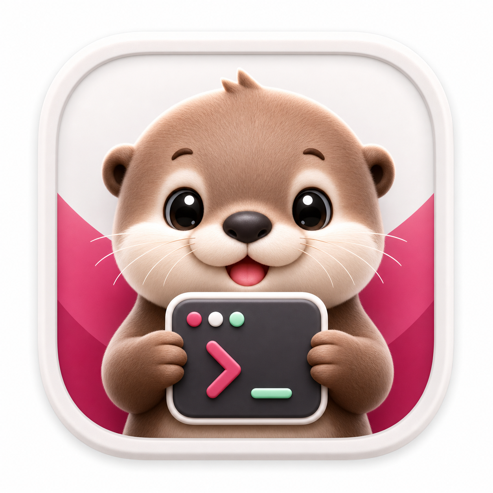
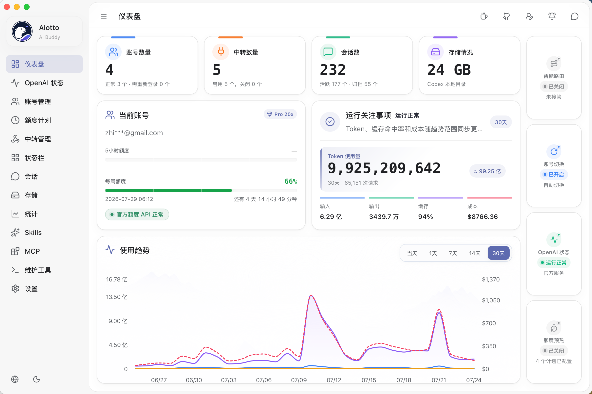

<p align="center">
  
</p>

<h1 align="center">Aiotto</h1>

<p align="center">
  <strong>Codex 多账号与多中转管理器</strong>
</p>

<p align="center">
  集中看额度、快速切换账号，把官方模型和多个中转模型放进同一个列表。
</p>

<p align="center">
  简体中文 · <a href="./README_EN.md">English</a>
</p>

<p align="center">
  <a href="https://github.com/ShawnZhuge/aiotto/releases/latest"></a>
  <a href="https://github.com/ShawnZhuge/aiotto/releases"></a>
  
  
  
</p>

<p align="center">
  <a href="https://github.com/ShawnZhuge/aiotto/releases/latest"><strong>下载最新版</strong></a>
  ·
  <a href="https://github.com/ShawnZhuge/aiotto/issues">问题反馈</a>
</p>

## 功能一览

| 功能 | 你能得到什么 |
| --- | --- |
| 账号管理 | 一次登记并保存账号快照；集中查看 5 小时和每周额度，一键切换到下一个可用账号 |
| 额度提醒 | 按剩余额度百分比设置提醒，达到阈值时提示切换，不用一直盯着进度条 |
| 多中转聚合 | 同时管理多个中转；有 ChatGPT 账号时，官方模型和中转模型出现在同一个 Codex 模型列表 |
| 无账号使用 | 没有 ChatGPT 账号也能使用无账号模式，直接选择已经接入的中转模型 |
| 手机远程使用 | 电脑端配置一次；使用同一 ChatGPT 账号在手机上远程操作电脑端 Codex 会话时，也能选择中转模型 |
| 额度预热 | 按计划自动发起预热任务，让额度窗口更贴合自己的工作时间 |
| macOS 状态栏 | 不打开主窗口也能查看账号额度、服务状态、中转和最近会话 |
| 会话与统计 | 查看历史会话、Token、缓存、请求量和折算金额，知道时间和额度花在了哪里 |
| 存储与维护 | 查看本地占用、备份与恢复、OpenAI 状态、Skills、MCP、更新和常见维护入口 |

## 重点解决的痛点

### 1. 账号多了以后，查看余额不方便，切换也慢

多个账号的 5 小时额度、每周额度和重置时间并不一致。平时要逐个登录确认，真正用到时又容易停在一个快见底的账号上。

Aiotto 把账号放在同一页：

- 账号完成一次登记后，保存为可切换的账号快照。
- 每张卡片直接显示套餐、登录状态、额度和重置时间。
- 点击账号卡片即可切换，也可以快速切到下一个可用账号。
- 可按剩余额度百分比设置提醒，到达阈值时提示换号。

<p align="center">
  
</p>

<p align="center"><sub>账号信息已做掩码；额度、状态和切换入口保留真实界面结构。</sub></p>

### 2. 中转不该每次只能用一个

常见做法是保存一个当前中转。要换到另一个中转时，再去改地址、模型或配置。中转一多，切换本身就成了工作。

Aiotto 会把多个中转聚合起来：

- 有 ChatGPT 账号：官方模型和多个中转模型放在同一个模型列表，需要哪个就选哪个。
- 没有 ChatGPT 账号：启用无账号使用模式，直接通过中转模型开始工作。
- 中转接入前可以查看模型、余额和延迟，并先做连接测试。
- 不再使用中转时，可以关闭路由并回到正常的官方模型使用方式。

| 使用场景 | 选择方式 |
| --- | --- |
| 有 ChatGPT 账号 | 官方模型、中转 A、中转 B 等同时出现在 Codex 模型列表 |
| 没有 ChatGPT 账号 | 开启无账号使用模式，直接选择中转模型 |
| 在手机上继续电脑任务 | 电脑端由 Aiotto 管理中转；手机使用同一 ChatGPT 账号远程操作这台电脑的 Codex 会话，并从列表选择中转模型 |

手机端不需要再录入一遍中转地址和密钥。中转仍由电脑端 Aiotto 管理，手机负责远程操作同一台电脑上的 Codex 会话。

## 另外几个常见麻烦

### 到了工作时间，额度窗口还没恢复好

额度预热可以按计划自动发起任务，让 5 小时额度窗口提前进入预期节奏。适合每天在固定时间集中使用 Codex，又不想临时等待额度恢复的人。

### 每次看余额都要打开主窗口

macOS 用户可以直接在顶部状态栏查看当前账号、额度、重置时间、中转状态、服务状态和最近会话，也能从这里进入常用操作。

### 历史会话很多，Token 花在哪也说不清

会话页可以搜索、继续、置顶、归档、恢复和导出历史任务。统计页按时间查看输入、输出、缓存、请求量、模型来源和折算金额，便于判断主要消耗来自哪里。

### 本地内容越积越多，又不敢直接清理

Aiotto 会展示 Codex 本地存储构成和会话占用，并提供备份、恢复预览和清理建议。OpenAI 状态、Skills、MCP、更新检查和常见维护入口也放在应用里。

## 一个仪表盘看全局

<p align="center">
  
</p>

<p align="center"><sub>账号、额度、中转、会话、存储、Token 与成本趋势集中展示；账号信息已做掩码。</sub></p>

## 下载与安装

Aiotto 支持 macOS 12 Monterey 或更高版本，以及 Windows 10/11 x64。

### macOS

1. 打开 [最新 Release](https://github.com/ShawnZhuge/aiotto/releases/latest)。
2. 下载文件名以 `_universal.dmg` 结尾的安装包。
3. 打开 DMG，把 Aiotto 拖入“应用程序”。

首次打开可能出现系统安全提示。请先确认文件来自本项目的 GitHub Release，然后在 Finder 中右键 Aiotto，选择“打开”。如果系统仍然阻止启动，可执行：

```bash
xattr -cr /Applications/Aiotto.app
```

### Windows

1. 打开 [最新 Release](https://github.com/ShawnZhuge/aiotto/releases/latest)。
2. 下载文件名以 `Windows-x64-Setup.exe` 结尾的安装器。
3. 按安装器提示完成安装。

首次打开可能出现系统安全提示。如果 Windows 阻止启动，请选择“更多信息”，核对应用名称和下载来源后继续运行。

## 常见问题

### 没有 ChatGPT 账号也能用吗？

可以。先在 Aiotto 中添加可用的中转并完成连接测试，再开启无账号使用模式。

### 有账号时还能继续使用官方模型吗？

可以。开启路由后，官方模型和中转模型会同时显示；关闭路由后会回到正常的官方使用方式。

### 手机上为什么也能看到中转模型？

电脑端 Aiotto 负责管理中转。使用同一 ChatGPT 账号从手机远程操作这台电脑上的 Codex 会话时，模型列表会包含已经接入的中转模型。

### Aiotto 会要求我提交账号密码吗？

不会。请先通过 ChatGPT 或 Codex 的正常流程完成登录，再由 Aiotto 保存账号快照。不要把密码、验证码或 Cookie 发给任何第三方。

### 为什么关闭窗口后 Aiotto 还在运行？

额度提醒和路由需要在后台保持可用。关闭窗口只会隐藏主界面；需要完全退出时，请使用 macOS 状态栏或 Windows 系统托盘里的“退出 Aiotto”。

## 安全与反馈

- 不要在 Issue、截图或日志中上传账号凭据、API Key、令牌或个人信息。
- 使用第三方中转前，请自行确认其计费方式、数据处理政策和服务条款。
- 遇到问题可以通过 [GitHub Issues](https://github.com/ShawnZhuge/aiotto/issues) 提交。

项目采用 [Apache License 2.0](LICENSE)。

Aiotto 是独立的 Codex 本地工作流工具，与 OpenAI 无隶属、背书或赞助关系。
